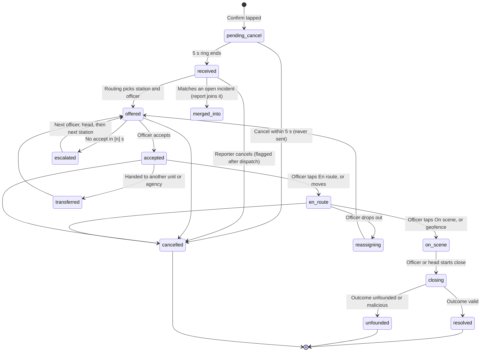
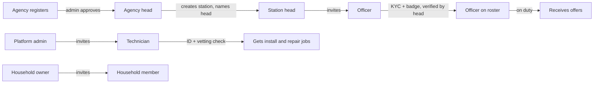

# Report tracking and data flow between users

Companion to [UX Gap Analysis.md](UX%20Gap%20Analysis.md). Drafted 2026-10-17 from the PRD, SRS, TRD, Backend Schema, States and Notifications, Rewards and Public Issues docs, and the canvas.

**The rule this document enforces:** every person in a process can see, at any moment, *what state it is in, who holds it now, what happens next and when*. Each role sees only the fields it is allowed to see.

Roles: **Citizen** (reporter, joiner, household owner or member) · **Emergency contact** (not a user — receives a link) · **Officer** · **Station** (head and dispatcher) · **Agency** (admin and finance) · **Platform admin** · **Technician** · **System** (routing, AI, devices, Paystack).

---

## Part A — Emergency report tracking

### A1. Two layers of state

- **Report** = one person's submission (`incident_reports`). States that only the sender sees: `sending → queued_offline → sms_sent → submitted`.
- **Incident** = the shared emergency (`incidents`). Every report on it — first, joined or from a device — follows one timeline.

Today the schema has one status machine on `incidents`. Add `incident_reports.delivery_state` for the per‑sender layer, and add these incident states and sub‑states, which the canvas and docs reference but the machine lacks: `offered`, `escalated`, `reassigning`, `transferred`, `closing`.

### A2. Incident state machine

`reinforced` is an **event, not a state**: it adds units while the incident stays where it is. `merged` and `split` are also events.

### A3. What the citizen sees in each state

The Live status screen always shows four things:
1. a **state title**;
2. **who holds it now** — the station, then the officer;
3. **what happens next and when** — a countdown or ETA;
4. a **freshness line**: "Live" with a pulsing dot, "Updated [n]s ago" in grey after 20 s, or "Reconnecting…" with SMS updates on.

| # | State | Title and line (citizen) | On screen | Citizen actions | Push / SMS |
|---|---|---|---|---|---|
| 0 | `pending_cancel` | **Sending in 5** — "Tap Cancel if this was a mistake." | Ring countdown, type, location line | Cancel | — |
| 0b | *queued_offline* (report) | **No connection** — "Your report is saved. We'll keep trying, and send it by SMS." | Retry spinner, attempts | Send by SMS now · Call 112 | — |
| 0c | *sms_sent* (report) | **Sent by SMS** — "We'll text you updates." | SMS sent time | Call 112 | SMS replies |
| 1 | `received` | **Report received** — "Finding the nearest [Police/Fire/…]." | Your pin, elapsed timer, safety tips for the type | Cancel (no fine for [30] s) · Add info · Share with contacts | P, I |
| 1b | joined | **Already being handled** — "You and [n] others reported this." | Shared timeline | Same incident? Yes/No · Add details | P, I |
| 2 | `offered` | **Contacting [Station]** — "Waiting for an officer to accept." | Station name, elapsed | As in 1 | — |
| 2b | `escalated` | **Still looking** — "Passing your report to the next team. Stay where you are." | Which team now | As in 1, plus Call 112 | P after [60] s |
| 3 | `accepted` | **Help accepted** — "[Officer] from [Station] is getting ready." | Officer card (photo, name, badge, rating) | Call (masked) · Message · Add info | P, S, I + success haptic |
| 4 | `en_route` | **On the way** — "About [n] min." | Live map, moving unit, ETA, route | As in 3 | ETA change > 5 min: P |
| 4b | `reassigning` | **Changing teams** — "[Name] can't come. We're sending another team." | Back to waiting, history kept | As in 1 | P |
| 4c | `transferred` | **Passed to [Agency]** — "They handle this kind of emergency." | New team | As in 1 | P |
| 4d | reinforced (event) | Banner: "More help is coming — [n] units." | Units list | — | P |
| 5 | `on_scene` | **Help has arrived** | Officer marker stops; your live location stops being shared | Message · Add info | P, I |
| 6 | `closing` | **Finishing up** — "The team is writing the report." | — | — | — |
| 7 | `resolved` | **Report closed** — the outcome in plain words | Summary, times, units | Rate → After‑care (tips, donate, thanks) | P, I |
| 7b | `unfounded` | **Closed** — "Officers could not confirm an emergency at this place." | Neutral wording; any fine comes as a separate notice with Appeal | See fine · Appeal | P, E, I (fine) |
| 7c | `cancelled` | **You cancelled this report** — the reason | If cancelled after dispatch: "Officers were already on the way." | — | I |

**Where the state also appears (all missing from the canvas today):**
- **Home:** a pinned "Live report" bar above the SOS button — type, state, ETA — that opens Live status. Home must never show only the SOS button while a report is live.
- **Lock screen:** iOS Live Activity and an Android ongoing notification showing state, ETA and the officer's first name, updated by push.
- **Activity:** each row has a state chip; open reports are pinned at the top.
- **SMS mode:** when the app is closed or offline, each state change from row 3 onward is also sent as a short SMS.
- **Discreet mode:** neutral text ("Your request is in progress"), no officer photo on the lock screen, silent.

**Timers each person sees** (from the specs):

| Timer | Default | Who sees it |
|---|---|---|
| Cancel ring | 5 s | Citizen |
| Free cancel | [30] s | Citizen ("No fine if you cancel now") |
| Officer accept window | Station setting [n] s | Officer (ring), station (row), citizen (no — sees "Contacting") |
| Escalation notice | [60] s | Citizen, station head |
| Free → flagged cancel | after `offered` | Citizen warning in the cancel sheet |
| Rate reminder | once after 24 h | Citizen |
| Clip access expiry | incident close + [n] h | Officer, station |

### A4. The same incident, seen by each role

| State | Officer | Station | Agency | Emergency contact | Platform admin |
|---|---|---|---|---|---|
| received | — | Queue row appears (slide‑in highlight), report count | Count on overview | — | Pin on live map |
| offered | Full‑screen offer, countdown, brief summary, distance | Row: "Offered to [Officer], [n] s left" | — | "[Name] asked for help. Finding the nearest team." | Same |
| escalated | Next officer gets the offer; the first sees "Expired, nothing recorded" | Red escalation banner, Assign unit | Alert if over [n] min | "Still finding a team" | Escalation counter |
| accepted / en_route | Navigate, brief, clips, team, call reporter (masked) | Unit on map, ETA, Reinforce, Transfer | Live count | "Help is on the way, about [n] min" | Same |
| on_scene | Notes, photos, statement request, Reinforce, **Panic** | Time on scene | — | "Help has arrived" | — |
| closing | Outcome form (code, valid/unfounded/malicious, evidence) | Review, can edit outcome | — | — | — |
| resolved | Rating arrives later, reward pending | Closed list, rating | Stats, rating | "[Name] is safe. Report closed." | Metrics |
| unfounded | Evidence stored | Fine case created | — | "Report closed" (neutral) | Fines queue |

**Emergency contacts** get an SMS with a time‑limited link to a minimal page: name, state, ETA, and the general area — never the exact building, the brief or the officer's identity. Off by default for violence and domestic reports and in discreet mode. The link expires 2 h after close.

### A5. Who sees which field

| Field | Citizen (reporter) | Joiner | Officer (assigned) | Station | Agency | Admin | Emergency contact |
|---|---|---|---|---|---|---|---|
| Reporter name | own | ❌ | "Verified citizen" (name on request, logged) | ✅ | ❌ (stats only) | ✅ | own contact's name |
| Reporter phone | own | ❌ | masked call relay | masked call relay | ❌ | reveal with reason (logged) | ❌ |
| Trust band | score (own) | ❌ | band | band | ❌ | score | ❌ |
| Exact building and postcode | ✅ | area only | ✅ | ✅ | ✅ (own agency) | ✅ | area only |
| Reporter live GPS | own | ❌ | until on_scene | until on_scene | ❌ | ❌ | if reporter opted in |
| AI brief | ❌ | ❌ | ✅ (advisory label) | ✅ editable | ❌ | ✅ | ❌ |
| Device clips | own cameras only | ❌ | while open, logged | while open, logged | ❌ | reason gate | ❌ |
| Officer name, photo, badge, rating | ✅ | ✅ | ✅ | ✅ | ✅ | ✅ | ❌ |
| Officer live location | until on_scene | until on_scene | team only | ✅ | ✅ | ✅ | ❌ (ETA only) |
| Timeline | simplified | simplified | full | full | full | full | 4 states |
| Notes and evidence | own added info | own | ✅ | ✅ | on export | ✅ | ❌ |
| Rating and comment | own | own | stars + comment, no reporter name | ✅ | aggregate | ✅ | ❌ |

All reads of a ❌‑to‑✅ crossing marked "logged" write to `audit_log` with actor, reason and incident.

### A6. Realtime delivery

Each role subscribes to its own **filtered view** of the incident. The server builds the view per role (A5), so a client never receives a field it may not show.

| Channel | Subscriber | Payload |
|---|---|---|
| `incident:{id}:reporter` | reporter + joiners | state, ETA, officer card, unit position (until on_scene), shared timeline |
| `incident:{id}:responder` | assigned officers | full incident view + brief + clips |
| `station:{id}` | head, dispatchers | queue changes, escalations, duplicates |
| `officer:{id}` | one officer | offers, reinforcement calls, panic from teammates |
| `agency:{id}` | agency staff | counts, escalations, billing alerts |
| `admin:ops` | admins | incidents, devices, system health |

**Fallback order for the citizen:** WebSocket → push (each state change) → SMS (state changes from `accepted` on, when the socket and push haven't been acknowledged within [20] s, or in SMS mode). On reconnect the client refetches `GET /incidents/{id}`; the server version always wins.

---

## Part B — Data flow for every other process

Format: each step names **who acts → what the system writes → who is told and what they see**. "Status shown" is what every party sees at that step.

### B1. Officer panic (new, MVP)
| Step | Actor → system | Who is told | Status shown |
|---|---|---|---|
| 1 | Officer holds the Panic button 2 s → `incident_events(kind=officer_panic)` with GPS | Station head + dispatchers (alarm), on‑duty officers within [n] km (offer to assist), agency head | Officer: "Help requested, [n] responding" |
| 2 | Responding officers accept → `incident_units` rows | Panicking officer sees the names and ETAs | Station: units on map |
| 3 | Officer or head clears it → event closed | All told "Cleared" | Logged; the reporter never sees it |

### B2. Tip → bounty
| Step | Actor → system | Who is told | Status shown (tipper / agency) |
|---|---|---|---|
| 1 | Citizen sends tip (category, details, media, postcode, anonymous?) → `tips` | Agency tips queue (anonymous number if chosen) | Sent / New |
| 2 | Routing → agency by category; matched to an open case? | Agency | Received by [Agency] / In queue |
| 3 | Agency records an outcome → `tip_claims` with suggested amount | Agency admin "Claim ready" | Under review / Claim to decide |
| 4a | Approve (pool ≥ amount, cap check, PIN) → ledger: pool −, tipper wallet + (held [n] days) | Tipper P, I | Approved, releases on [date] / Paid |
| 4b | Ask for more → tipper adds info | Tipper | Agency needs more info |
| 4c | Decline with reason | Tipper | Not eligible (reason) |
| 5 | Hold ends → available to withdraw | Tipper | Available |
| — | Tip proven false → trust event | Tipper I | Could not be confirmed |
Tipper identity: held by the platform; the agency sees `Tipper #[no.]` unless the tipper agrees otherwise. Admin reveals only with a reason (logged).

### B3. Public issue (non‑emergency)
| Step | Actor → system | Who is told | Status shown |
|---|---|---|---|
| 1 | Citizen picks category, photo, postcode → merges with any case within [100] m | Agency in charge | Sent / New case or "+1" |
| 2 | Agency assigns → work order (asset linked if managed) | Reporters P | Assigned to [Agency] |
| 3 | Work starts | Reporters | In progress, target date |
| 4 | Fixed with photo | Reporters asked "Is it fixed?" | Awaiting your check |
| 5 | Yes from ≥ [n] reporters, or [n] days with no "No" → closed | All | Fixed |
| 5b | "Not fixed" → reopened | Agency | Reopened |
| — | Escalate PDF/link to a superior (view‑only, expires) | Superior | — |

### B4. Household subscription → install → devices
| Step | Actor → system | Who is told | Status shown (owner / admin / technician) |
|---|---|---|---|
| 1 | Owner picks plan, confirms postcode, confirms they are the owner or have the owner's permission | — | Plan chosen |
| 2 | Pays the install fee (Paystack webhook) → `subscriptions(status=install_pending)` | Admin Installation queue | Paid, book a visit / Install pending |
| 3 | Owner picks a slot → `install_jobs` | Assigned technician (job) | Visit booked [date] / Scheduled / New job |
| 4 | Technician en route → on site | Owner P "Technician on the way" (name, photo, badge) | Technician on the way |
| 5 | Installs, scans serials, devices report online | Admin device wall | Installing / Waiting for devices |
| 6 | Owner gives the confirmation code → job closed | Owner, admin | **Active** — the billing period starts here, not at payment |
| 7 | Monthly charge → dunning stages if it fails | Owner (stage messages), admin | Per stage (Payment problem screen) |
| 8 | Owner invites members → `property_members` | Member accepts | Member: view rights set by the owner |

### B5. Device fault → repair
| Step | Actor → system | Who is told | Status shown |
|---|---|---|---|
| 1a | Owner reports a problem / 1b device raises offline or tamper | Admin ticket; tamper also → nearest station | Reported |
| 2 | Admin assigns a technician + slot | Owner, technician | Visit booked |
| 3 | Not covered by the plan → quote | Owner must accept before work | Quote waiting for you |
| 4 | Technician on the way → fixed | Owner | Fixed — confirm |
| 5 | Device back online → ticket closed | Admin | Closed |

### B6. Camera access (any viewer)
Owner/member: own cameras, no reason needed. Officer/station: only devices near an open incident assigned to them, until close + [n] h. Admin/technician: reason required → `camera_access_log` → the owner can see "Who viewed my camera" in Camera view (add to the canvas). Street‑light controls: admin, or an officer during an incident; the owner's boost is limited to [n] per night.

### B7. Statement
| Step | Actor → system | Who is told | Status shown (citizen / officer) |
|---|---|---|---|
| 1 | Officer requests a statement on an incident | Citizen P | Statement requested / Requested |
| 2 | Citizen records/types in their language → AI English text | — | Draft / Waiting |
| 3 | Citizen corrects, signs with PIN/face → sealed v1 | Officer | Signed / Received |
| 4 | Officer asks for a change → request | Citizen | Change requested |
| 5 | Citizen signs v2 (v1 kept) | Officer | Signed v2 |
| — | Low AI confidence → admin review queue; certified translation on request | — | "Translation check pending" |
Every view and download → audit.

### B8. False alarm → fine → appeal
| Step | Actor → system | Who is told | Status shown |
|---|---|---|---|
| 1 | Officer closes as unfounded/malicious with evidence | Station review | — |
| 2 | Policy: warnings first, then a fine → `fines` | Citizen P, E, I | Warning / Fine [Amount], appeal by [date] |
| 3 | Citizen appeals (reason ≥ [20] chars, evidence) | Admin appeals queue | Appealed |
| 4 | Admin waives / reduces / upholds (reason) | Citizen | Decided |
| 5 | Pays (wallet or Paystack) → share to the agency per policy | Agency ledger | Paid |
Joiners of a confirmed incident are never fined. Fines never delay a later report.

### B9. Money between users

Every movement is a ledger pair. A balance changes only from a webhook or an approved internal transfer.

| Flow | From → to | Approvals | Who sees what |
|---|---|---|---|
| Fund wallet | Paystack → citizen wallet | webhook | Citizen: Pending → Funded |
| Donation | Citizen wallet/Paystack → agency / station / officer, split by agency rule, minus platform fee | — | Donor: receipt. Receiver: amount, and the donor's name only if the donor agrees. Admin: ledger |
| Response reward | Rewards pool → officers on the incident, split by the agency rule | auto, caps, anti‑gaming | Officer: "Pending [n] days" → Available |
| Bounty | Agency pool → tipper | agency approve (+ manual review above [Amount]) | Tipper: held → available |
| Fine payment | Citizen → platform, agency share | — | Citizen receipt; agency ledger |
| Subscription | Owner card/wallet → platform | webhook | Owner receipts |
| Agency invoice | Agency → platform | webhook or finance confirmation | Agency billing |
| Withdrawal | Wallet → own bank (name match) | PIN; first one delayed; daily limit | Pending → Sent → Arrived / Failed → refunded to wallet |
| Agency payout | Agency balance → agency subaccount | second approver above [Amount] | Agency payouts; admin payout detail |

### B10. Onboarding chains (who unlocks whom)

Each invite has a status the inviter can see — Sent, Opened, Verifying, Pending approval, Active, Expired — with Resend and Revoke.

### B11. Messaging (CRM)
Sender (admin or agency) → draft → approval when large or urgent (second admin / agency admin) → queued (respects quiet hours) → push → SMS if unread → WhatsApp if opted in. The results page shows sent, delivered, read and failed per recipient group, with cost per channel. Recipients see it in Notifications. Safety messages can't be opted out of.

---

## Part C — What to add to the canvas and specs

1. Schema: `incident_reports.delivery_state`; incident states `offered`, `escalated`, `reassigning`, `transferred`, `closing`; `emergency_contacts`; `technician` role; `panic` event kind; a `tracking_links` table (contact links that expire).
2. Citizen: Home live‑report bar · Live status in every state from A3 (only "En route" is drawn) · lock‑screen live activity · emergency contact link page · cancel sheet · SMS mode banner · "Who viewed my camera".
3. Officer: Panic button + alarm screen · status stepper · close form · "taken by another unit".
4. Station: escalation banner · panic alarm · state column in the queue · per‑role realtime filtering.
5. Status pages, each with a timeline, for: tips (B2), public issues (B3), install (B4), repair (B5), statements (B7), fines (B8), withdrawals and payouts (B9), invites (B10).
6. API: role‑filtered incident views (`GET /incidents/{id}` returns the caller's projection); `POST /incidents/{id}/panic`; `POST /me/emergency-contacts`; `GET /track/{token}`.
